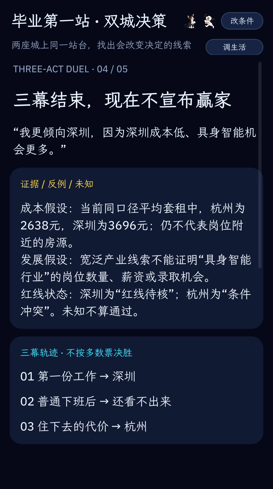
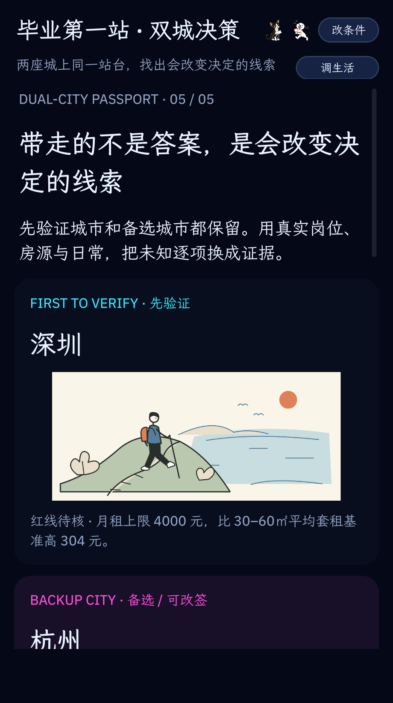

# 毕业第一站

**两座城上同一站台，找出最可能改变决定的那件事。**



**GOSIM Agentic App 2026｜写作与创作赛道｜MOST暴躁队｜Leinstein** · [初赛仓库登记](https://github.com/gosimfoundation/hackathon-agenticapp26/issues/13#issuecomment-5964776262)

> 🎬 **评审视频：** [在 B 站观看《毕业第一站》项目介绍](https://www.bilibili.com/video/BV1gvpy6qEho/)｜从毕业生为什么需要它，到双城 PK、证据边界与当前实现

毕业生通常不是在全国城市中等待一个算法答案，而是在两三座看起来都不错的城市之间纠结。真正困难的是：自己相信“这座城机会更多、成本更低、生活更好玩”，却不知道哪一条判断最需要先核验。

《毕业第一站》v0.6 把城市推荐器改造成**双城决策实验室**。它保留积木与车站的低门槛体验，但不再宣布“最适合你的城市”。应用帮助用户留下两座候选、封存原始倾向，在三幕对局里拆开发展、日常和落地条件，最后由用户亲自选择先验证哪座城，并带走现实核验任务。

当前版本为 **v0.6.0**。参赛主交付是 OctoSense 原生 Script App：[bundle/main.splash](bundle/main.splash)，[GitHub Release](https://github.com/SuperLeilei2026/city-matchmaker/releases/tag/v0.6.0) 同时提供密封 pack 与 [82 秒版本影片](https://github.com/SuperLeilei2026/city-matchmaker/releases/download/v0.6.0/graduation-first-station-v0.6.mp4)；面向评审的完整项目介绍另见 [B 站成片](https://www.bilibili.com/video/BV1gvpy6qEho/)。Web 版用于快速试玩与展示；App Hub 人工审核状态以[发布记录](docs/publication.md)为准。

## 怎么玩

1. **选择入口。** 已经纠结城市的人直接带来2–4座候选；还没有方向的人先用生活取舍、行业与兴趣生成候选。
2. **装上现实条件。** 填写具体职业方向、最多三个兴趣、月租上限和不能接受的气候红线。MBTI/星座只做票角签名，不参与排序。
3. **亲手留下两城。** 系统只给候选顺序、入围理由、资料覆盖和约束状态，不展示总相合指数。
4. **完成三幕 PK。** 依次比较“第一份工作”“普通下班后”“住下去的代价”。每幕都展示生活草稿、可核验线索与未知，用户可以选择左城、右城或“还看不出”。
5. **审计原始判断。** 应用把“深圳成本更低”“成都压力小”等句子当作待验证假设，给出已有证据、反例和信息缺口，不把它们塞进城市分数。
6. **签发双城通行证。** 用户明确选择先验证城市，另一座保留为备选；通行证记录三幕轨迹、三项现实核验任务和改选条件。



## 核心产品判断

产品已经可以提供两种价值：

- **情绪与体验价值：** 车站、双轨、三幕和通行证让沉重决策变得愿意开始。
- **决策整理价值：** 它把“我更喜欢某城”拆成事实、编辑判断和未知，并给出下一步行动。

它仍然不能提供预测价值。城市级产业、活动和租金资料不能证明个人会拿到 offer、获得 WLB、租到理想房子或更快乐。应用不输出幸福概率、录取概率、薪资预测或唯一赢家。

预算与健康/气候红线先于偏好比较：

- **无已知冲突：** 当前资料没有发现所选约束冲突；
- **条件冲突：** 现有资料出现冲突，需要用户决定是否承担；
- **红线待核：** 关键资料缺失，未知不算通过。

城市级租金只表示压力。即使预算高于基准，也不能推出岗位附近“住得起”；预算覆盖后不会继续制造额外高分。详细规则见[匹配模型](docs/matching-model.md)，资料边界见[数据说明](docs/data-sources.md)。

## 两份固定验收档案

- **小陈：** 具身智能、散步与阅读、月租上限4000元、潮湿闷热为健康红线，在深圳与杭州之间比较。结果必须指出：深圳成本低缺少当前同口径支持；泛 AI 资料不能证明具身智能岗位；深圳湿度资料缺失属于“红线待核”。
- **小雷：** AI、游泳健身与演出、月租上限8000元、不愿持续闷热，在上海、杭州、成都之间比较。结果必须指出：成都压力小不能从城市标签推导；游泳健身资料不足；预算覆盖三城后不应主导顺序。

这些是**合成回归档案**，还不是两位真实用户的可用性结论。下一步需要让对应用户亲自试玩，再记录她们在哪一幕觉得“说中了”或“完全不是这么回事”。

## Agentic 能力

原生 AppCard 的系统 Agent 是“决胜提问官”。它读取两座城、三幕平局、用户担忧与资料缺口，只能返回：

```text
DQ1|资料版本|左城ID|右城ID|career/daily/landing|一个问题|一项核验任务
```

应用会验证协议、城市 ID、资料版本、对局版本、维度、长度和换行。Agent 不能修改排序、候选、投票或先验证城市；任务只有在用户点击“加入核验清单”后才保存。参考 `card-host` 不提供模型服务时，应用自动使用本地规则，核心流程仍可完成。

Web 版不调用模型，始终使用同一套本地决胜规则。v0.6 在真实参考宿主通过2项生产失败回退和38项临时响应注入检查；注入测试不是模型调用。当前签名包另在完整 OctoSense Shell 中完成一次 MiniMax-M3 真实调用、用户确认、存档和重启恢复；这仍不能证明 Kimi、模型故障切换、推荐准确率或真人满意度。

## 运行

Web：

```sh
npm start
```

打开 <http://127.0.0.1:4318>。页面仅加载本地脚本、资料和素材，存档保存在当前浏览器。

原生 AppCard：

```sh
OCTO_CARD_HOST=/path/to/card-host \
OCTO_HUB=/path/to/hub \
./tools/run-native.sh
```

修改模板或资料后重新生成：

```sh
python3 tools/build_bundle.py
/path/to/hub stamp bundle
/path/to/hub check bundle --allow-unsigned
```

原生源码模板是 [tools/main.template.splash](tools/main.template.splash)，[bundle/main.splash](bundle/main.splash) 是生成产物。

## 验证

```sh
npm test
OCTO_CARD_HOST=/path/to/card-host OCTO_HUB=/path/to/hub \
  python3 tools/native_departure_smoke.py
OCTO_CARD_HOST=/path/to/card-host OCTO_HUB=/path/to/hub \
  python3 tools/native_agent_smoke.py
```

自动测试覆盖约束与偏好分离、未知不算通过、预算饱和、原始倾向不改排序、三幕不自动产生赢家、刷新恢复和旧存档迁移。原生真实宿主测试覆盖小陈全流程、Agent 失败回退、确认后保存与重启恢复。

[原生流程报告](qa/native-departure-check.json) · [原生截图](qa/native-departure-v0.6) · [Agent 协议报告](qa/native-agent-check.json) · [真实模型全链路](qa/real-agent-e2e-v0.6/README.md) · [Web 验收](docs/web-qa.md) · [隐私说明](docs/privacy.md)

## 仓库结构

```text
bundle/                         App Hub 候选包、权限、素材与商店截图
tools/main.template.splash      原生 OctoScript UI 与状态源码
tools/build_bundle.py           将共享城市资料编入原生包
core/departure.mjs              候选排序与约束状态
core/duel.mjs                   三幕、假设审计与本地决胜问题
core/experience-state.mjs       五阶段存档与旧版迁移
data/                           城市、租金与来源状态
web/                            可试玩 Web 双城版与 PNG 通行证
tests/  qa/                     自动测试、真实宿主证据与截图
docs/                           产品、模型、数据、隐私和发布边界
```

[Apache-2.0](LICENSE) · [素材声明](NOTICE) · [问题与建议](https://github.com/SuperLeilei2026/city-matchmaker/issues)
