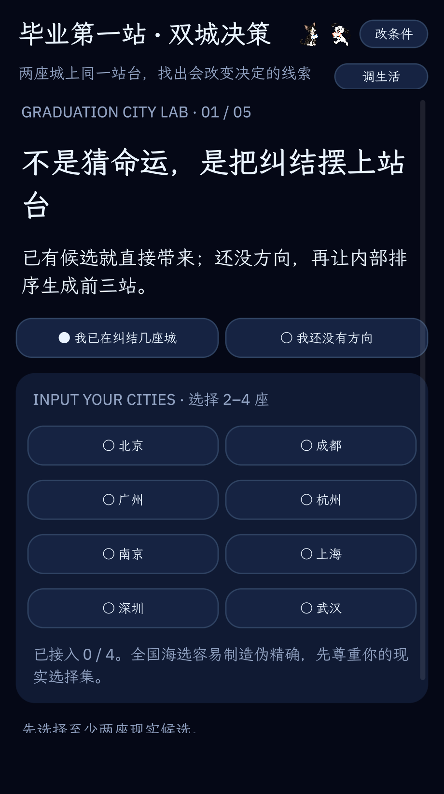
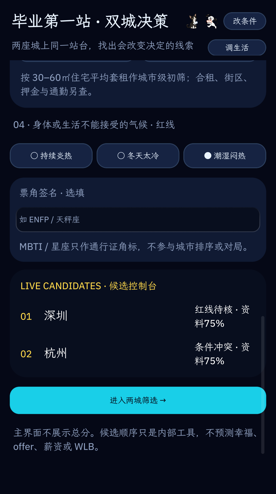
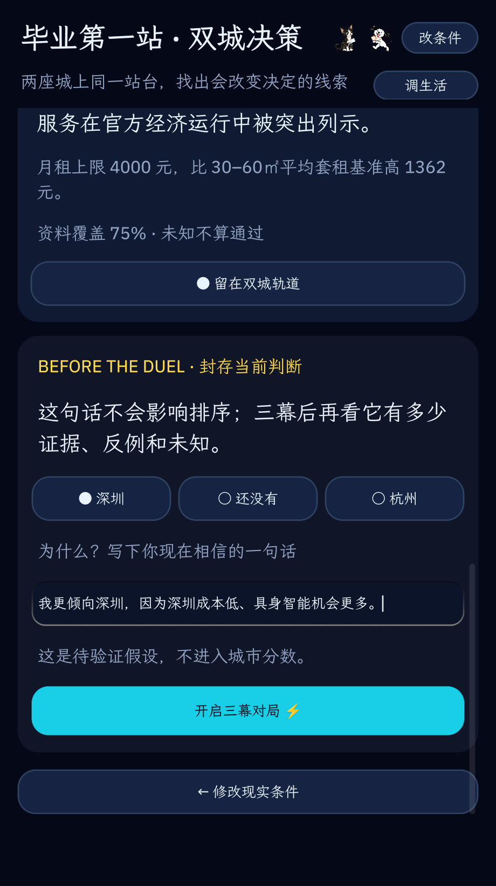

# 毕业第一站 v0.6 · 当前演示证据

更新：2026-10-14。v0.6 已有真实原生窗口截图、真实模型全链路和操作报告。新版影片单独按[视频方案](video-treatment.md)制作；旧版影片只作历史追溯。

## 五阶段原生流程

### 1. 带来现实候选

### 2. 装上具体方向、兴趣、预算和红线

### 3. 亲手留下两城并封存原始判断

### 4. 完成三幕，审计证据、反例与未知

### 5. 选择先验证城市，生成双城通行证

[操作报告](../qa/native-departure-check.json)记录12项真实窗口检查。输入采用小陈合成档案，没有读取个人资料，也没有调用模型。

## Web 演示

运行 `npm start` 后打开 <http://127.0.0.1:4318>。Web 与原生版共享五阶段状态和双城规则；Web 提供更丰富的分屏轨道动效与 PNG 通行证，并使用本地决胜问题，不调用模型。实际走查见 [web-qa.md](web-qa.md)。

## Agent 证据边界

参考 `card-host` 不提供模型服务。v0.6 在真实生产界面验证2项失败回退与确认保存，并在临时复制包中验证38项 `CM1`/`DQ1` 协议保护；见 [native-agent-check.json](../qa/native-agent-check.json)。注入响应不是 MiniMax/Kimi 调用。

当前最终签名包已在完整 OctoSense Shell 中，以合成小陈式档案跑通一次 MiniMax-M3：首次同意、提案、任务确认、首城选择与重启恢复均有证据，见[真实模型全链路](../qa/real-agent-e2e-v0.6/README.md)。一次调用不代表 Kimi、故障切换、建议准确率或真人价值已验证。

## 建议演示脚本

使用小陈档案，控制在60–90秒：

1. 深圳、杭州入场；
2. 具身智能、散步、阅读、4000元、潮湿红线；
3. 说出“深圳成本低、机会更多”；
4. 三幕投票；
5. 展示成本反例、行业粒度缺口与红线未知；
6. Agent 提出关键一问，用户确认任务；
7. 用户选择先验证深圳，杭州保留为备选。

镜头重点是判断如何被拆开，而不是快速点完所有按钮。
